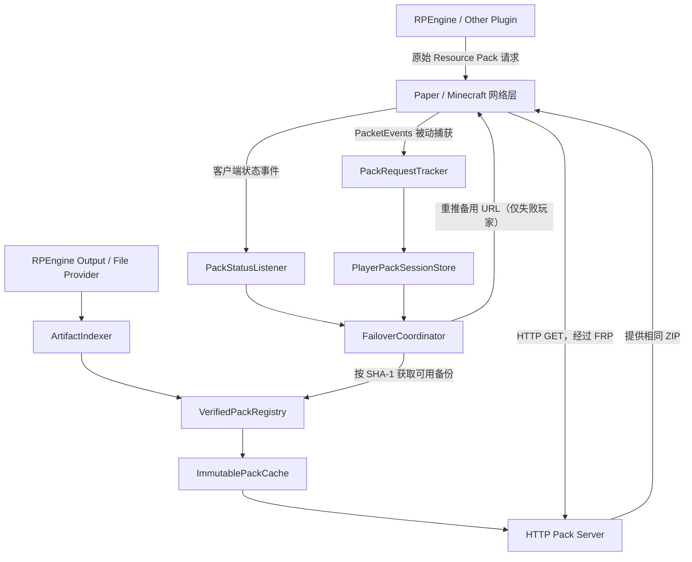

# PackFailover：Paper 资源包故障转移插件

> **文档用途：交给 Codex 的架构设计与分阶段开发任务书**  
> **项目状态：设计草案，尚未实现；部分兼容行为必须通过 PoC 验证**  
> **编写日期：2026-10-19**  
> **开发基线：Paper 26.2 / Java 25 / Gradle Kotlin DSL / PacketEvents 2.x（需核实兼容性）**  
> **建议署名：cody**  
> **建议许可证：MIT（创建仓库时再确认）**

---

## 0. 给 Codex 的执行说明（请先读）

> **优先级说明：** 仓库中的 `AGENTS.md` 定义执行规则；本文为架构与阶段验收细则。发生不一致时，优先采用已确认的 Paper 26.2 / Java 25 版本要求，并报告差异。

你是一名熟悉 Paper、Minecraft Java 资源包协议、PacketEvents、Java 网络编程和 Gradle 的开发工程师。请按此文档设计、实现、测试 **PackFailover**。目标是建立一个**小型、非侵入式、可扩展的资源包下载故障转移插件**，而不是另写一个资源包生成器或替代现有资源包管理插件。

**最优先的任务不是实现所有功能，而是验证关键协议兼容性。** 开始编码之前：

1. 检查目标 Paper 服务器及 PacketEvents 的**实际版本**，阅读该版本 Java API/Javadoc；不得凭猜测编造方法名、数据包字段、Gradle 坐标。
2. 做一个最小 PoC：捕获 RPEngine 发出的资源包请求，记录 `pack UUID / URL / SHA-1 / required / prompt`；监听相同 UUID 的下载状态；模拟 `FAILED_DOWNLOAD`；重新推送**字节完全相同**的资源包但更换为本地备用 URL；观察是否成功、是否保留堆叠、是否与 RPEngine 状态管理冲突。
3. **PoC 未通过，不能宣称通用透明故障转移已实现。** 要先记录失败行为和适配方案，再决定使用相同 UUID、重新分配 UUID 或与上游插件协同。
4. 不要为了编译成功而关闭关键校验，也不要以清空全部资源包、取消其他插件推送、无上限重试等方式“解决”问题。
5. 每一阶段都提供 `./gradlew build` 结果、代码改动、测试说明、已知限制与下一步；优先可运行、可回滚的增量实现。

### 验收用例（当前真实问题）

RPEngine 使用 `host.mode: upload`，某些 Java 玩家能下载官方资源包，另一些玩家收到：

```text
[RPEngine] <player>'s game could not download
https://packs.resourcepack.ai/h/<sha1>.zip (FAILED_DOWNLOAD)
```

目标是：**仅让下载失败的玩家改从运营者自有资源包服务器下载相同 ZIP**；其他玩家维持原始下载路径，不受到额外提示、延迟或资源包变化。

---

## 1. 部署背景与系统约束

目标环境（以实际运行状态为准）：

- Minecraft Java 服务器：**Paper 26.2**，使用 **Java 25**，由 Docker Compose 部署在 Ubuntu 主机上。
- 公网入口：独立的 FRPS 公网服务器，FRPC 在 Minecraft 主机上做 **TCP** 透明转发；Java 玩家经公网 TCP 游戏端口接入。
- 已使用：**RPEngine、Geyser-Spigot、Floodgate-Spigot、PacketEvents** 等插件。
- RPEngine 当前可用的主资源包大约 2.1 MB；包哈希在不同版本会变化，**不可在代码里写死**。
- RPEngine 配置保留官方上传为首选：

```yaml
host:
  enabled: true
  mode: upload
```

- 使用自己的备用 HTTP 入口，例如 `http://<PUBLIC_HOST>:8181/packs/<sha1>.zip`。**公网 IP、端口均可配置，示例值不是固定实现。**
- RPEngine 的 `content/` 可能包含旧版备份目录；备份必须移出扫描目录，不能把内容冲突当成网络故障。
- 最小支持对象：**Java Edition 玩家**；**Bedrock / Geyser / Floodgate** 的 `.mcpack` 和资源包传输路径与 Java 不同，V0.1 不负责 Bedrock 资源包故障转移。

### 明确不做的事

- 不修改 RPEngine 源码或拦截/替换其所有资源包。
- 不要求玩家安装 Mod，不要求所有玩家切换下载源。
- 不强制更改 FRP 游戏端口规则（只新增可选的 HTTP 备用出口）。
- 不负责 ZIP 合并、图片转换、生成资源包、基岩版 `.mcpack` 传送。
- 不做通用 URL 代理、全站爬取、远程执行、任意文件下载。
- 不自动绕过玩家主动拒绝使用服务器资源包的决定。

---

## 2. 产品定义与需求优先级

### 必须实现（V0.1）

- **被动监听**其他插件向玩家发送的 Java 资源包信息，不篡改正常推送流程。
- **跟踪单玩家单资源包**的状态，以玩家 UUID + pack UUID + 会话/代次关联，不靠玩家名字或仅靠 URL。
- 收到当前主资源包的 `FAILED_DOWNLOAD` 时，若能找到哈希一致、完整可读且已发布的本地文件，只对**该玩家**触发一次备用重推送。
- 备用 ZIP 由插件提供 HTTP GET/HEAD 服务（推荐）或可选使用外部静态文件 URL（扩展）。
- **完整 SHA-1 一致性校验**：不允许错发、过期发、重压缩后混用旧哈希；客户端必须得到与原请求相同的 ZIP 字节。
- 过滤仅处理白名单主来源（如 `packs.resourcepack.ai`），避免误操作其他插件、其他资源包。
- 不把 `DECLINED` 当成下载失败；`FAILED_RELOAD` 与下载失败分别处理。
- 防止重试循环、跨玩家串包、旧会话状态覆盖新会话、服务器卡顿/网络超时阻塞游戏主线程。
- 打印可诊断但不泄露敏感信息的日志，支持 `/pf status`、`/pf reload` 和 `/pf debug <player>`（具体命令前缀以实现为准）。
- 允许管理员关闭插件或单独关闭 `fallback`，一键恢复 RPEngine 原有行为。

### 可选（V0.2+）

- 对 ItemsAdder、Oraxen、Nexo、其他资源包插件提供文件目录适配器。
- 多 ZIP、堆叠资源包独立重试、分组来源匹配、额外的外部备用镜像。
- Prometheus 或结构化指标、容量与失败统计、可选按用户“会话内首选镜像”。
- 防盗链令牌、HTTPS 反代、限流、文件过期回收策略等完善部署能力。
- Bedrock/Floodgate 路径另立设计案，不直接沿用 Java 资源包推送逻辑。

---

## 3. 总体架构



**模块划分与职责边界**

| 模块 | 单一职责 | 不应承担的工作 |
|---|---|---|
| `PackRequestTracker` | 监听服务器发出的资源包推送包；提取 UUID、URL、SHA-1、required、prompt、阶段、时间戳 | 不修改原数据包，不下载 ZIP |
| `PackStatusListener` | 消费 Paper `PlayerResourcePackStatusEvent`，提取 UUID 和状态 | 不以废弃 `getHash()` 作为哈希来源 |
| `PlayerPackSessionStore` | 维护每个玩家、资源包、当前连接会话状态和重试代次 | 不持久化玩家敏感数据 |
| `FailoverCoordinator` | 决策状态转移、验证先决条件、异步调度并执行一次重试 | 不做阻塞磁盘 IO，不扫描全部 ZIP |
| `PackProvider` | 从插件目录或自定义目录识别候选文件 | 不自行重建资源包，不擅自修改其他插件文件 |
| `ArtifactIndexer` | 计算 SHA-1、校验 ZIP 并更新索引 | 不在 Paper 主线程做大文件 SHA-1 |
| `VerifiedPackRegistry` | `sha1 -> artifact` 的映射（附文件大小和来源） | 不以短哈希作为唯一键 |
| `ImmutablePackCache` | 把验证过的 ZIP 存成不可变版本，安全保留旧版本 | 不覆盖正在被 HTTP 服务读取的文件 |
| `HttpPackServer` | 按 SHA-1 返回可验证的 ZIP，处理 GET/HEAD | 不开放任意文件路径或 URL 代理 |
| `ConfigManager` | 加载/验证配置，热更新安全配置项 | 不静默覆盖管理员设置 |
| `CommandHandler` | 管理命令、状态与诊断 | 不开放给默认普通玩家 |

建议采用简单依赖注入（构造器注入），核心逻辑不直接依赖 Bukkit 静态 API，以便单元测试。小项目先使用**单 Gradle Module**，避免过早拆分。

---

## 4. Minecraft 资源包事件与追踪策略

### 4.1 已知 API 边界

- Paper `PlayerResourcePackStatusEvent` 支持 `getID()`（资源包 UUID）和 `getStatus()`（结果）；`getHash()` 已废弃且客户端不再返回可靠的哈希，**不能依赖**。
- Paper 玩家资源包发送 API 支持指定资源包 UUID、URL、哈希及 required/prompt；具体使用 `Player.addResourcePack(...)`、`Player.setResourcePack(...)` 或新版 Adventure API，由 Codex 根据目标 Paper 版本核实。**不能凭空假设使用同一 UUID 二次推送一定有效。**
- PacketEvents 2.x 文档显示存在配置阶段 `WrapperConfigServerResourcePackSend` 与游戏阶段 `WrapperPlayServerResourcePackSend`；实际字段和监听优先级按最终依赖版本核实。
- **配置阶段难点**：资源包请求可能早于 `PlayerJoinEvent`；状态回包可能发生在登录/配置阶段，需要检查 Paper `PlayerResourcePackStatusEvent` 是否能够在该阶段对应触发。若不能，需要额外监听客户端资源包状态包或实施稳健的阶段桥接。

### 4.2 请求捕获记录

```text
PackRequestRecord
  playerId: UUID           # 服务器玩家 UUID；在配置阶段可能需要临时 connection id
  connectionEpoch: long    # 同一玩家每次重新连接都递增
  packId: UUID             # 原始资源包 UUID
  primaryUrl: URI
  sha1: 40-hex | Unknown
  required: boolean
  prompt: Component | Optional
  source: enum/identifier
  protocolPhase: CONFIGURATION | PLAY
  sentAt: Instant
  attemptGeneration: long
```

安全/一致性规则：

- 仅接受严格合法的 `http` / `https` 资源包地址；**主来源 URL 必须匹配管理员配置的主机白名单**（主机名而非任意子串匹配）。
- 若没能捕获完整哈希，不可凭截断的 8 位 hash 推断版本，更不可盲目发最新版。可以在 Provider 获得文件的可信 SHA-1 后，根据明确可验证的绑定关系继续；否则记为 `UNMATCHED`，不自动回退。
- 用 `(connectionEpoch, playerUUID, packUUID, attemptGeneration)` 做事件相关性检查，丢弃旧连接/旧推送状态。
- 拦截器应识别**自己发出的备用资源包**（由已登记的 `packUUID + generation`、本地 URI 或内部发送标记判定），绝不能把备用请求再登记成原始请求造成循环。
- 数据包回调只采集数据并投入有界队列，**不能进行同步文件扫描、SHA-1 计算、HTTP 请求或主线程 Bukkit API 调用**。

### 4.3 状态枚举与转移

```text
PRIMARY_PENDING
   ├── SUCCESSFULLY_LOADED --> PRIMARY_LOADED [结束]
   ├── DOWNLOADED ---------> PRIMARY_DOWNLOADED [继续等 LOAD]
   ├── FAILED_DOWNLOAD ----> FALLBACK_ELIGIBILITY_CHECK
   ├── DECLINED -----------> DECLINED [结束，不重试]
   ├── FAILED_RELOAD ------> FAILED_RELOAD [记日志，默认不切源]
   └── 其他状态 ------------> 记录并按事件语义处理

FALLBACK_ELIGIBILITY_CHECK
   ├── 无匹配 ZIP / 不可达 / 超限 --> SKIPPED [结束]
   └── 条件满足 --> FALLBACK_PENDING

FALLBACK_PENDING
   ├── SUCCESSFULLY_LOADED --> RECOVERED [结束]
   ├── FAILED_DOWNLOAD ----> EXHAUSTED [结束]
   ├── DECLINED -----------> DECLINED [结束]
   ├── 玩家离线 ------------> CANCELLED [结束]
   └── 超时 ----------------> TIMEOUT [结束]
```

注意：客户端可能返回 `DOWNLOADED` 后再返回 `SUCCESSFULLY_LOADED`；不要将 `DOWNLOADED` 视为最终成功。具体存在的事件枚举值以目标 API 为准，**不要写无法编译的猜测枚举**。超时只用于清理与报告，不代表可判断客户端网络具体原因。

### 4.4 故障转移伪代码（设计语义，不是照抄即编译的实现）

```java
void onPackStatus(PlayerContext player, UUID packId, PackStatus status) {
    PackAttempt a = sessions.findCurrent(player.connectionEpoch(), packId);
    if (a == null || a.isTerminal()) return;

    if (status == FAILED_DOWNLOAD && a.isPrimary() && a.retryCount() == 0) {
        a.markChecking();
        ioExecutor.execute(() -> {
            Optional<VerifiedArtifact> match = registry.findBySha1(a.sha1());
            if (match.isEmpty() || !httpServer.isReady()) {
                reportSkipped(a, "missing_artifact_or_http_not_ready");
                return;
            }
            // 必须在服务器正确线程/调度上下文使用 Paper 玩家 API
            scheduleOnPlayerThread(player, () -> {
                if (!sessions.isStillCurrent(a) || !player.isOnline()) return;
                sessions.markFallbackPending(a);
                sendFallbackPack(a, match.get().publicUrl());
            });
        });
    }
}
```

**重点验证：** 对客户端来说“同一 UUID + 不同 URL + 同一 SHA-1”是否真的会重新发起下载，以及是否影响已有堆叠和 RPEngine 的资源包状态追踪。如果不行，必须设计新的 ID 关联映射和清理策略，并验证不会多装一层重复包；不可自行假定成功。

### 4.5 与强制资源包的交互

- `required=true` 时，Minecraft 客户端/原插件可能在失败后直接断开玩家，**故障转移插件未必有机会推送备用包**。
- V0.1 默认支持 `required=false` 或能在失败后保持连接的情形；对 required 的支持要由 PoC 决定。
- **不得为了“兜底”主动把原插件 `required=true` 改成 `false`**，也不应悄悄阻止上游插件的踢出操作。

---

## 5. 本地 ZIP 来源、缓存与准确性

### 5.1 PackProvider 接口草案

```java
public interface PackProvider {
    String id();
    Collection<Path> discoverCandidates() throws IOException;
}

public record VerifiedArtifact(
    String providerId,
    String sha1Hex,
    Path immutableFile,
    long sizeBytes,
    Instant indexedAt
) {}
```

推荐插件适配分层：

1. `DirectoryPackProvider`（V0.1 必须实现）：管理员明确列出本地资源包目录，仅扫描匹配 ZIP 的文件。
2. `RPEnginePackProvider`（V0.1 薄包装）：默认定位 `plugins/RPEngine/output`，必须先验证当前版本实际生成文件路径、结构与刷新时机；若不匹配，打印提示并允许配置覆盖。
3. `RegisteredPackProvider`（V0.2）：其他插件经服务 API 显式注册文件和 hash。

不可假设所有插件都把 ZIP 放在同一目录；不能自动递归扫描整个 `plugins/` 或游戏世界文件夹。

### 5.2 文件验证与缓存

1. 有界扫描候选 ZIP，校验路径在配置的允许根目录内（处理符号链接/路径规范化）。
2. 异步计算整个 ZIP 的 **SHA-1（40 位十六进制）**；可选做 ZIP 基本结构与 `pack.mcmeta` 可读检查；**不解压可执行内容**。
3. 将已校验文件复制到私有缓存的临时文件并再次确认哈希，原子重命名成 `<sha1>.zip`。
4. 更新不可变快照 `Map<sha1, VerifiedArtifact>`，以供查找和 HTTP 服务使用；多线程安全、无半写入状态。
5. 如果 RPEngine `/rp reload` 后产生新 ZIP，保留在用的旧版缓存文件一段时间，不立即覆盖/删除。
6. 自动清理仅清理无活跃引用、过期且超过保留策略的旧 ZIP；避免并发 HTTP 下载时删文件。

SHA-1 在 Minecraft 资源包场景主要用于协议规定的版本一致性，不应把它当成抗恶意篡改的唯一安全机制。文件来源仍必须可信，并限制 HTTP 服务器仅发布管理员允许的资源包。

---

## 6. HTTP 备用服务

### 6.1 简化接口

```text
GET  /packs/<sha1>.zip   -> 200 application/zip + ZIP bytes
HEAD /packs/<sha1>.zip   -> 200 headers only
未知 hash / 非法路径     -> 404
不支持方法               -> 405
```

实现要点：

- 仅接受严格的 40 位 hex SHA-1 路径，绝不以 URL 路径拼接任意文件系统路径。
- 返回 `Content-Length`、`Content-Type: application/zip`、适当的 `Cache-Control`；可以使用 `ETag`。Range 请求可作为后续增强，先验证 Java 客户端是否需要。
- 有界工作线程池、连接限制、读写超时、并发/带宽限额、最大资源包体积；无资源包时就绪检查应报告不可用。
- HTTP 读文件从不可变缓存读，支持多玩家同时下载。
- 服务绑定 `0.0.0.0:8181` **容器内部**以允许 Docker 端口发布；公网访问地址由 `public-url` 配置提供。
- 仅暴露 ZIP 的固定路径，不允许目录列表、管理面板、日志目录和 `plugins/` 文件访问。
- 若未来提供 TLS，优先经现有反向代理；不要让一个临时自签证书导致客户端 HTTPS 失败。

### 6.2 URL 构造

```text
public-url = http://<公网域名或 IP>:<FRPS-映射端口>
resource-url = <public-url>/packs/<完整 SHA-1>.zip
```

`public-url` 是**客户端访问入口**，不是容器监听地址。禁止将 `127.0.0.1` 或 Docker 内网 IP 作为公网玩家下载链接。

### 6.3 部署拓扑

```text
玩家 Java 客户端
  ├─ Minecraft TCP :25565 ------> FRPS ------> FRPC ------> Docker Paper :25565
  └─ HTTP GET 备用 :8181 --------> FRPS ------> FRPC ------> Docker PackFailover :8181

正常路径：RPEngine upload -> https://packs.resourcepack.ai/...
仅下载失败：PackFailover -> http://<PUBLIC_HOST>:8181/packs/<sha1>.zip
```

在 Docker Compose 中，**追加**（不要覆盖现有 `ports:`）：

```yaml
services:
  paper:
    ports:
      - "127.0.0.1:8181:8181/tcp"
```

在 Minecraft 专用 `frpc.toml` 中，追加独立 TCP 映射（**仅示例**）：

```toml
[[proxies]]
name = "packfailover-http"
type = "tcp"
localIP = "127.0.0.1"
localPort = 8181
remotePort = 8181
```

还需要：FRPS 允许指定远程端口，公网安全组/防火墙允许 `8181/TCP`。FRPS 端口占用时可改用其他远程端口，只需保持 `public-url` 与实际公网入口一致。**不要把服务端 RPEngine 的 `host.mode` 从 `upload` 改成 `own-port`**，否则不再符合“失败玩家才切源”的方案。

以上所有部署命令在容器名称、端口、工作路径被确认之后执行，**不得假定一定叫 `paper-26.2`**。

---

## 7. 线程、并发和生命周期

- Paper 事件/玩家 API 调用必须遵守服务器线程模型。PoC 先以标准 Paper 主线程调度实现；如果以后支持 Folia，抽象 `PlayerScheduler` 并单独测试。
- PacketEvents 网络回调是线程敏感区域：只记录轻量元数据。将散列计算、扫描、复制、HTTP IO 放到受控异步执行器。
- 核心会话存储按玩家分片或使用线程安全结构；状态迁移需要原子比较（CAS 或串行调度），防止两次 `FAILED_DOWNLOAD` 导致重复重推。
- 限制队列长度与活跃玩家资源包追踪条目数；过载时跳过兜底，而不是拖垮 Paper。
- 玩家断线、切换资源包、插件停用和服务器重启时：取消待重试任务、释放会话引用、关闭 HTTP 服务、终止后台线程池。
- 先启动 HTTP 与加载已验证缓存，再将 `ready=true` 发布给状态机；若 HTTP 未就绪则原插件继续正常运行，不发不可达 URL。
- 兼容其他插件在后续重新推送同一 pack UUID 的情况：把它视为新一代请求，老一代状态不得覆盖。
- 使用 `plugin.yml` 明确 PacketEvents 依赖；核对目标版本的 `api-version` 与 `depend`/`softdepend`，不要自创依赖字段。

---

## 8. 安全性与可观察性

### 安全硬要求

- 备用 HTTP 服务只提供本地可信、已经校验过的 ZIP，不做代理、反代外部任意 URL、文件上传或远程命令接口。
- 对路径穿越 (`../`)、符号链接越界、无效 SHA-1、非法编码的 URL、超大 ZIP、有毒 ZIP 元数据等进行负面测试。
- 资源包刷新与 GET 并发时，永远从完整、不可变的 ZIP 读取。
- 下载目录不可指向 SSH 密钥、凭证目录、世界存档等敏感路径；默认值限定插件目录和显式授权 Provider 路径。
- 每玩家每包默认只重试一次，失败时终止，不通过频繁重推绕过用户拒绝。
- 管理命令权限默认 OP；日志默认不记录玩家 IP 与敏感完整 URL query 参数。

### 日志建议

```text
[PackFailover] indexed provider=rpengine sha1=... size=2190344
[PackFailover] captured player=... packId=... source=resourcepack.ai
[PackFailover] primary_failed player=... packId=... status=FAILED_DOWNLOAD
[PackFailover] fallback_sent player=... packId=... sha1=... url=... 
[PackFailover] recovered player=... packId=...
[PackFailover] skipped player=... reason=no_verified_artifact
```

默认日志做适度采样；详细 trace 仅管理员手动开启，支持查看追踪数、备用成功率、当前缓存空间、HTTP 请求计数和异常计数。

---

## 9. 可配置项（提案，不是现有插件配置）

```yaml
# PackFailover V0.1 - design example
enabled: true

tracking:
  use-packetevents: true
  primary-host-allowlist:
    - "packs.resourcepack.ai"
  track-config-phase: true
  track-play-phase: true

providers:
  directories:
    - id: rpengine
      enabled: true
      path: "plugins/RPEngine/output"
      glob: "**/*.zip"
      max-depth: 3

fallback:
  enabled: true
  only-on-failed-download: true
  max-attempts-per-pack: 1
  delay-ticks: 20
  session-ttl-seconds: 180
  preserve-pack-id: true # 条件：PoC 已验证；否则必须实现经测试的替代策略
  respect-declined: true

http:
  enabled: true
  bind-address: "0.0.0.0"
  port: 8181
  public-url: "http://YOUR_PUBLIC_HOST:8181"
  max-connections: 32
  worker-threads: 4
  max-pack-size-mb: 100

cache:
  directory: "plugins/PackFailover/cache"
  keep-old-versions: 3
  minimum-retention-minutes: 60

bedrock:
  enabled: false

logging:
  debug: false
```

配置管理器必须对 `public-url`、端口范围、目录、SHA-1 长度、并发数、最大文件大小和重试次数做严格校验。`/pf reload` 可以重载匹配规则与日志设置；**监听端口等需要重新绑定的配置可以明确要求重启**，不必勉强所有选项热更。

---

## 10. 建议工程结构

```text
PackFailover/
├── README.md
├── LICENSE
├── settings.gradle.kts
├── build.gradle.kts
├── gradle.properties
├── docs/
│   ├── ARCHITECTURE.md
│   ├── PROTOCOL-POC.md
│   ├── INSTALLATION.md
│   └── TEST-PLAN.md
└── src/
    ├── main/
    │   ├── java/dev/cody/packfailover/
    │   │   ├── PackFailoverPlugin.java
    │   │   ├── config/{ConfigManager,PackFailoverConfig}.java
    │   │   ├── tracking/{PackRequestTracker,PackStatusListener}.java
    │   │   ├── session/{PlayerPackSessionStore,PackAttempt,PackState}.java
    │   │   ├── failover/{FailoverCoordinator,RetrySender}.java
    │   │   ├── provider/{PackProvider,DirectoryPackProvider,RPEnginePackProvider}.java
    │   │   ├── cache/{ArtifactIndexer,VerifiedPackRegistry,ImmutablePackCache}.java
    │   │   ├── http/{HttpPackServer,PackHttpHandler}.java
    │   │   ├── command/PackFailoverCommand.java
    │   │   └── util/{Sha1Utils,ThreadGate}.java
    │   └── resources/{plugin.yml,config.yml}
    └── test/
        └── java/dev/cody/packfailover/
            ├── failover/FailoverCoordinatorTest.java
            ├── cache/ArtifactIndexerTest.java
            └── http/PackHttpServerTest.java
```

名称/目录是建议，不构成框架强制规范。把协议有关的字段映射封装起来，便于升级 PacketEvents 和 Paper 时只修改适配层。

---

## 11. 分阶段任务与完成定义（必须逐阶段推进）

### 阶段 0：环境核验与 PoC（BLOCKER）

**实施清单**

1. 记录 Paper、Minecraft、Java、PacketEvents、RPEngine 的实际版本，以及目标服务器使用的 `plugin.yml` 或 `paper-plugin.yml` 插件加载规范。
2. 写最小插件捕获原始资源包 push 的 UUID、URL、SHA-1、required、prompt 与网络协议阶段；测试在 `PlayerJoin` 前后能否捕获。
3. 监听资源包状态事件，将事件 UUID 与发送记录严格关联；尝试在 Minecraft Java 客户端中强制构造无效主 URL，取得 `FAILED_DOWNLOAD`。
4. 为相同 ZIP 准备可达备用 HTTP URL，**尝试重用原 UUID**，验证能否成功加载、是否再次尝试下载、是否影响资源包堆叠及 RPEngine UI。
5. 复测必需包（required）、多包、重新入服、RPEngine `/rp reload`、并发多人场景。
6. 把实际抓取数据、结果截图/日志、API 兼容点写在 `docs/PROTOCOL-POC.md`。不通过则记录 blocker，并提出可验证替代设计。

**PoC 通过标准**：至少一个真实 Java 客户端完整证明“原 URL 下载失败 -> 同一 ZIP 的备用 URL 成功加载 -> 上游 UI 正常 -> 没有无限循环/包堆叠损坏”。

### 阶段 1：V0.1 MVP

- 完成配置、Provider、SHA-1 索引、不可变缓存和小型 HTTP 服务器。
- 完成捕获/状态/故障转移协调器，默认只对 allowlist 的包执行一次重试。
- 完成线程安全、退出清理、基本日志与管理命令。
- 让 `./gradlew clean build` 稳定通过，至少覆盖模块级自动测试。
- 在测试服完成真实客户端端到端测试（不能只跑 JUnit）。
- 输出安装指南、Docker/FRP 示例、回滚步骤。

### 阶段 2：V0.2 通用化

- 扩展更多 PackProvider，并明确说明“通用”的前提是获得**原始推送元数据与字节一致的备用 ZIP**。
- 支持多资源包来源、多包堆叠、对特定插件配置优先级与回退策略。
- 提供供第三方扩展的 Provider API、指标和更完整的文档/CI。

---

## 12. 测试矩阵（Codex 应实现与记录）

| 用例 | 预期行为 |
|---|---|
| 主站资源包正常下载 | 不触发备用推送 |
| 单个玩家 `FAILED_DOWNLOAD`，缓存匹配 | 只向该玩家推送备用地址，成功后停止 |
| 另一玩家同时正常下载 | 不受影响，无多余提示 |
| 备用资源包 ZIP 不存在 | 记 `no_verified_artifact`，不盲目重发 |
| ZIP 与原始 SHA-1 不一致 | 拒绝重试，记录不匹配 |
| 玩家主动 `DECLINED` | 不重试 |
| `FAILED_RELOAD`（资源包已下载但加载失败） | 默认不切源，明确记录 |
| 备用下载再次失败 | 达到上限结束，绝不无限循环 |
| 玩家下载期间退出/重新进入 | 旧连接任务取消，新会话独立 |
| 资源包更新时多人正在下载旧版 | 旧版仍可完整下载，新版指向新 hash |
| 同玩家多个包堆叠 | 不清空、不替换其他包 |
| 资源包包 UUID 重复推送 | 基于 generation 正确判断当前尝试 |
| 配置阶段就发资源包 | 可跟踪，或在报告中明确列为限制 |
| `required=true` 失败 | 不声称一定能救回玩家；记录实测结果 |
| HTTP 非法方法、非法路径、目录穿越 | 405/404，不泄露文件 |
| 单 IP 高频下载/并发下载 | 有界资源占用，Paper TPS 不显著受影响 |
| Bedrock 玩家连接 | 不错误推送 Java 资源包，不抛异常 |
| PacketEvents 缺失/版本不兼容 | 清晰禁用故障转移，不崩服 |
| 关闭 PackFailover | 原 RPEngine 推送行为恢复原样 |

### 最小端到端复现步骤

1. RPEngine 仍采用 `host.mode: upload`；确认资源包来源为官方 HTTPS 托管。
2. 本地插件缓存含有与官方 URL 同 SHA-1 的 ZIP，内置 HTTP 下载用外部浏览器/`curl` 能访问并核实 SHA-1。
3. 只对一名测试 Java 玩家在其可控客户端环境阻断官方域名，而不阻断备用地址（不要修改生产网络或全体玩家 DNS）。
4. 观察原资源包失败事件、一次备用推送、备用 HTTP GET、成功加载与 UI 显示；另一测试玩家保持原路径成功。
5. 重复测试 `rp reload` 改变 SHA-1 与多个包堆叠的情形。

---

## 13. 推荐技术选择（以实际 API 验证为准）

- Java 版本：**固定 Java 25**；Gradle Java toolchain = 25，Java compile `--release 25`；构建机须安装 JDK 25。
- 构建：优先 **Gradle 9.8 + Kotlin DSL**；Paper 26.2 API `compileOnly`（Codex 需查证实际可解析的 Maven 坐标）；PacketEvents 2.x 必须核验对 26.2 的兼容性，按官方文档选择稳定依赖与合适的编译范围。
- 主插件格式：优先 `plugin.yml` 以简化兼容性；Paper 新式 `paper-plugin.yml` 只有确有需要时再引入。
- HTTP：V0.1 使用 JDK `com.sun.net.httpserver.HttpServer` 或经过审查的轻量服务；异步执行器隔离 HTTP、磁盘操作。
- 单元测试：JUnit 5；核心状态机不依赖真实服务器；可选 MockBukkit 但必须核对目标版本兼容性。
- CI：GitHub Actions Gradle build，生产端到端测试单独运行。

**重要**：源码中不允许使用 `PlayerResourcePackStatusEvent.getHash()` 作为匹配依据；不要通过手动拼接不完整 SHA-1 来生成资源包链接；不要默认 RPEngine 的 output 目录布局不变。

---

## 14. 关键设计决策（须由 PoC 完成后填写）

| 决策 | 当前假设 | 需要验证的问题 |
|---|---|---|
| PacketEvents 捕获资源包 | 支持 CONFIGURATION 与 PLAY 包 | 两个阶段实际事件是否均能捕获？ |
| 发送元数据 | 可以拿到 URL、SHA-1、pack UUID、required、prompt | 当前版本的字段/包装器名称是什么？ |
| 服务端状态监听 | Paper `PlayerResourcePackStatusEvent` 可提供 UUID 和状态 | 配置阶段能否精确相关？ |
| 同 UUID 改 URL | **待验证，不可直接视为成立** | 客户端会重新下载吗？上游状态会受影响吗？ |
| 不同 UUID 重推备选 | 仅在同 UUID 方案失败后评估 | 是否堆叠重复包？清理安全么？ |
| 哈希到本地 ZIP | 完整 SHA-1 可匹配 | RPEngine 发布的哈希对应输出中的哪一个 ZIP？ |
| required 资源包 | 可能在失败后已断线 | 是否可以在踢出前转发？是否需要上游协作？ |
| Floodgate | V0.1 排除 Bedrock 资源包转换 | 是否可通过玩家类型可靠识别而跳过？ |
| FRP | TCP 透明转发 8181 | 测试玩家能否实际从公网访问 ZIP？ |

没有完成验证的项必须标记 **UNKNOWN / BLOCKED**，不可在 README 中写成“已支持”。

---

## 15. 参考官方文档

- RPEngine Configuration：<https://resourcepack.ai/docs/rp-engine/config>
- RPEngine Commands：<https://resourcepack.ai/docs/rp-engine/commands>
- Paper 26.2 Player API：<https://jd.papermc.io/paper/26.2/org/bukkit/entity/Player.html>
- Paper ResourcePackStatusEvent：<https://jd.papermc.io/paper/1.21.8/org/bukkit/event/player/PlayerResourcePackStatusEvent.html>
- Paper `plugin.yml`：<https://docs.papermc.io/paper/dev/plugin-yml/>
- PacketEvents Javadocs：<https://javadocs.packetevents.com/>
- PacketEvents 源码：<https://github.com/retrooper/packetevents>

注意：链接可能对应不同 API 版本。Codex 必须以项目最终选定的具体版本为准，复核方法签名与协议行为。

---

## 16. 可直接复制给 Codex 的首条任务

> 在当前仓库中实现 **PackFailover 的阶段 0 PoC**，以 `docs/ARCHITECTURE.md` 为完整架构基线，并遵守仓库根目录 `AGENTS.md`。目标确定为 Paper 26.2 + Java 25；请核实 PacketEvents 与 RPEngine 实际版本，未提供的版本需列出核对步骤；阅读相应官方 API，然后创建最小可编译 Gradle 插件：使用 PacketEvents 监听配置/游戏阶段服务端资源包推送，记录 UUID、URL、SHA-1、required 和 prompt；监听 Paper `PlayerResourcePackStatusEvent`，按玩家会话和资源包 UUID 关联；提供可手动触发的模拟失败/备用推送测试入口。**不要先开发全部 HTTP 托管与通用适配器。** 请先验证同一资源包 UUID 下更换 URL 的行为，并在 `docs/PROTOCOL-POC.md` 写出实际测试步骤、观察结果、兼容问题、最终决策。编译不过或 API 不兼容时必须修正到可以构建，不得伪造通过结果。对需要真实客户端才能验证的部分明确标注“尚待人工端到端测试”，停止在该验证门槛上等待结果。

**PoC 确认通过后**，再按第 11 节推进 V0.1、V0.2，不要跳步。
